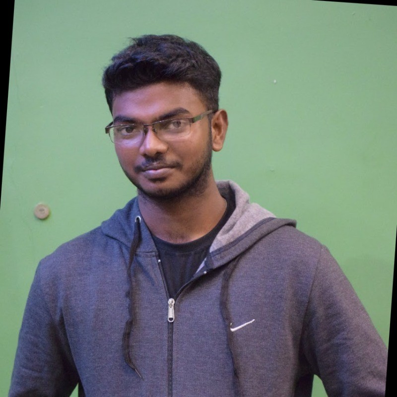

<section class="intro">
  
  

    <h1>Hello! I’m Sivadinesh Ponrajan.</h1>
    
You can call me <strong>Shiva</strong>. I’m a PhD researcher working on AI safety, adversarial robustness and mechanistic interpretability. I am pursuing my PhD through <strong><a href="https://www.hh.se/english/">Halmstad University</a> × <a href="https://www.cybercampus.se/">Cybercampus Sweden</a></strong>. I am supervised by <strong><a href="https://prayagtiwari.github.io/">Prayag Tiwari</a></strong> at Halmstad University and <strong><a href="https://www.su.se/english/profiles/s/stax4356">Stefan Axelsson</a></strong> at Stockholm University.

    
📍 Halmstad, Sweden

    
<a href="/publications/">Research</a> / <a href="/cv/">CV</a> / <a href="https://www.linkedin.com/in/sivadineshponrajan/">LinkedIn</a> / <a href="https://github.com/SivadineshPonrajan/">GitHub</a>

  

</section>

## 🔬 Research focus

AI safety · Adversarial robustness · Mechanistic interpretability · Agent security · Weight-space forensics

## ✨ Selected highlights

- **🎉 NeurIPS Workshop Accepted** - Research on permission drift in quantized tool-calling language models.
- **🤞🏻 Three manuscripts under review** across AI safety, model stability and weight-space forensics.
- **Current PhD research** on adversarially robust vision-language models, reward hacking, task gaming and unexpected behaviour in autonomous AI agents.
- Previously worked with **Halmstad University × Polisen Sverige** on [AI-Powered Crime Scene Analysis](https://www.hh.se/english/research/research-programmes/firp---future-industry-research-programme/research-projects-firp/ai-powered-crime-scene-analysis.html), developing soft real-time 3D reconstruction of crime scenes with Neural Radiance Fields (NeRF).

## 💼 Experience

  <article>Nov 2025 - Present<h3>PhD Researcher</h3>
<a href="https://www.hh.se/english/">Halmstad University</a> × <a href="https://www.cybercampus.se/">Cybercampus Sweden</a>
</article>
  <article>Jan - Oct 2025<h3>Research Engineer</h3>
<a href="https://www.hh.se/english/research/research-programmes/firp---future-industry-research-programme/research-projects-firp/ai-powered-crime-scene-analysis.html">Halmstad University × Polisen Sverige</a>
</article>
  <article>Feb - Jun 2024<h3>Master Thesis Student</h3>
<a href="https://www.inf.elte.hu/en/neural-information-processing-research-group">ELTE Neural Information Processing Research Group</a>, Budapest, Hungary
</article>
  <article>Feb 2021 - Jun 2022<h3>Software Engineer</h3>
<a href="https://www.prodapt.com/">Prodapt Solutions</a>, Chennai, India
</article>
  <article>2019 - 2020<h3>Research and Engineering Internships</h3>
Gurugram Cyber Crime Cell, <a href="https://rheo.ai/">Rheo AI</a>, <a href="https://www.zoho.com/">Zoho</a> and Zion Robotics
</article>

## 🎓 Training & certifications

- **BlueDot Impact** - Technical AI Safety, 2026 **([🔗 Link](https://bluedot.org/certification?id=recZHsPI03iBpG4Jy))**
- **NVIDIA Deep Learning Institute** - Exploring Adversarial Machine Learning, 2025 **([🔗 Link](https://learn.nvidia.com/certificates?id=ObWpgEOTTRevRbtLh7RRrg#))**
- **AWS Certified AI Practitioner** - 2024 **([🔗 Link](https://www.credly.com/badges/7d8e24ba-e991-4ff6-86a9-5b6bdd79b5ea/public_url))**
- **Palantir Foundry Foundations** - 2025 **([🔗 Link](https://verify.skilljar.com/c/9k85d7cybef5))**
- **Udacity** - Flying Car and Autonomous Flight Engineer, 2020 **([🔗 Link](https://www.udacity.com/certificate/69CQCACA))**
- **DeepLearning.AI / Coursera** - TensorFlow Developer Specialization, 2020 **([🔗 Link](https://www.coursera.org/account/accomplishments/specialization/certificate/ZWXLTGA7QYF3))**
